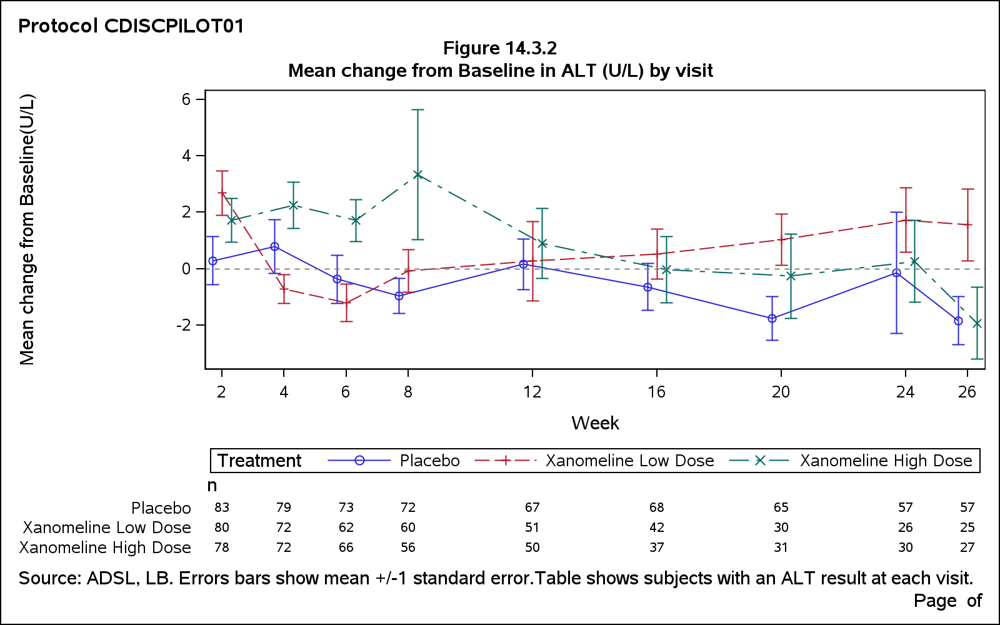

# Clinical Trial Summary Reporting Pipeline

A portfolio project demonstrating entry-level Clinical SAS programming skills:
SDTM-to-ADaM derivation, Table/Listing/Figure (TLF) production, and
ODS-formatted study report output — the core workflow at CROs.

---

## Study background

**Study:** CDISCPILOT01 — a Phase 3 Alzheimer's disease trial  
**Sponsor:** Eli Lilly (CDISC pilot submission)  
**Data source:** [CDISC SDTM/ADaM Pilot Project](https://github.com/cdisc-org/sdtm-adam-pilot-project)  
**Treatment arms:** Placebo · Xanomeline Low Dose (54 mg) · Xanomeline High Dose (81 mg)  
**Analysis population:** 254 randomised subjects (306 screened; 52 screen failures excluded)

---

## What this pipeline produces

| Output file | Description |
|---|---|
| `table_14_1_1.pdf/.rtf` | Table 14.1.1 — Demographics & Baseline Characteristics |
| `table_14_3_1.pdf/.rtf` | Table 14.3.1 — Subjects with Adverse Events by Worst Severity |
| `figure_14_3_2.pdf/.png` | Figure 14.3.2 — Mean Change from Baseline in ALT by Visit |

### Key results

- **Analysis population:** 254 subjects (Placebo 86, Low Dose 84, High Dose 84)
- **Mean age:** 75.1 years (SD 8.25); 87% aged 65 or older
- **Subjects with any AE:** 225/254 (88.6%)
  - Placebo 80.2% · Low Dose 91.7% · High Dose 94.0%
- **ALT change from baseline:** small and non-directional across all arms and visits
  (one Placebo subject at Week 24 had ALT rise from 13 to 124 U/L, inflating that
  arm's SD at that visit; see `docs/derivation_notes.md`)

---

## Project structure
---

## How to reproduce

### 1. Get the data

Download the following `.xpt` files from the
[CDISC pilot repo](https://github.com/cdisc-org/sdtm-adam-pilot-project)
under `updated-pilot-submission-package/900172/`:

| File | Folder | Path in repo |
|---|---|---|
| `dm.xpt` | sdtm/ | `.../tabulations/sdtm/` |
| `ae.xpt` | sdtm/ | `.../tabulations/sdtm/` |
| `vs.xpt` | sdtm/ | `.../tabulations/sdtm/` |
| `lb.xpt` | sdtm/ | `.../tabulations/sdtm/` |
| `adsl.xpt` | adam/ | `.../analysis/adam/datasets/` |
| `adae.xpt` | adam/ | `.../analysis/adam/datasets/` |

Data are provided by CDISC for educational use. Please review the repo's
own licence terms before using or distributing the files.

### 2. Set up SAS

Access: [SAS OnDemand for Academics](https://welcome.oda.sas.com/) (free)  
Environment: SAS Studio

Upload the six `.xpt` files to `~/Cdisc_project/sdtm/` and
`~/Cdisc_project/adam/` using the Server Files and Folders pane.

### 3. Run the pipeline

1. Open `programs/run_all.sas` in SAS Studio.
2. On line 18, confirm `%let root = /home/<your-username>/Cdisc_project;`.
3. Click **Run** (F8).
4. Check the Log tab — all seven `NOTE: ... completed successfully.` lines
   should appear with no ERROR lines.

### 4. Check the output

After a successful run, download from `output/`:

- `table_14_1_1.pdf` — Demographics table, one landscape page
- `table_14_3_1.pdf` — AE summary table, one landscape page
- `figure_14_3_2.png` — ALT trend chart
### ALT Trend Figure

The figure below shows the mean change from baseline in ALT (U/L) by visit.

---

## Skills demonstrated

| Skill | Where used |
|---|---|
| SDTM domain reading (XPORT engine) | `01_import_explore.sas` |
| PROC CONTENTS / FREQ / MEANS — data exploration | `01_import_explore.sas` |
| ADaM-style subject-level derivation | `02_derive_adsl.sas` |
| DATA step merge (many-to-one, inner join, `in=` flags) | `03_derive_ae_alt.sas` |
| `first.` / `last.` by-group processing | `03_derive_ae_alt.sas` |
| Change from baseline derivation | `03_derive_ae_alt.sas` |
| PROC TABULATE / PROC REPORT | `04_table_demog.sas`, `05_table_ae.sas` |
| User-defined formats (`PROC FORMAT`, permanent library) | `00_setup.sas` |
| ODS RTF / ODS PDF with titles, footnotes, page numbers | `04_table_demog.sas`, `05_table_ae.sas`, `06_figure_alt.sas` |
| PROC SGPLOT — line chart with error bars and n table | `06_figure_alt.sas` |
| Macro variables (`%let`, `%include`, `proc sql into`) | throughout |
| Reproducible pipeline with `run_all.sas` | `run_all.sas` |

---

## Author

B.Pharm final year · SAS Programmer Professional Certificate (Coursera)  
Preparing for SAS Certified Specialist: Base Programming Using SAS 9.4  
Open to Clinical SAS Programmer Trainee / Statistical Programmer I roles
